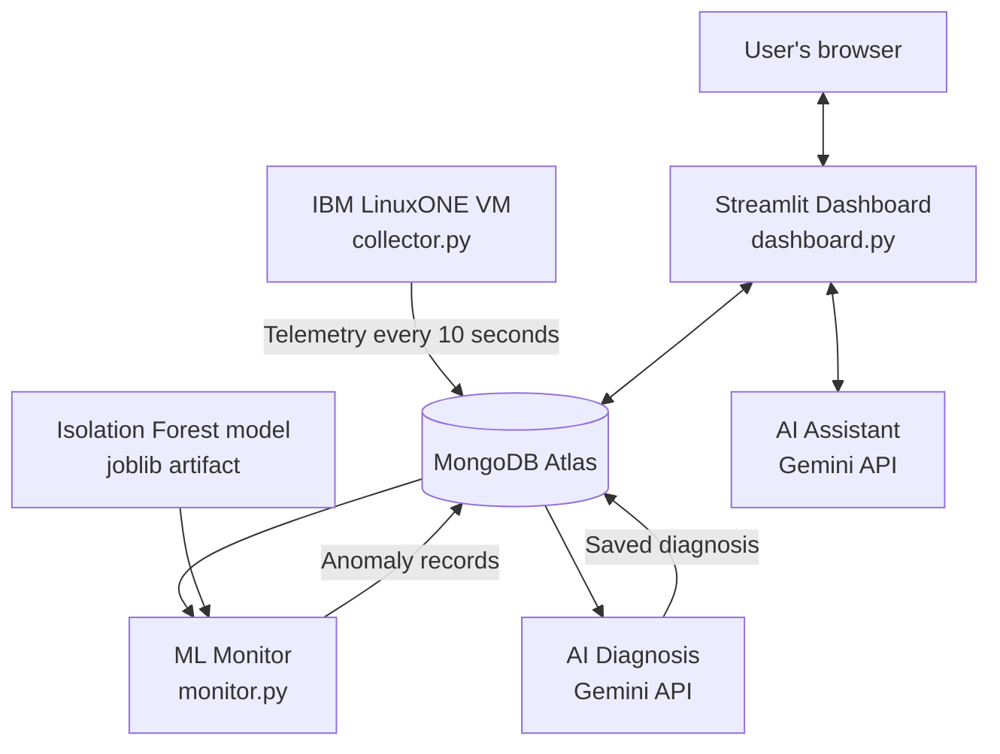

# AgentGuard Z

**Real-Time AI for Critical Decisions | IBM Z Datathon 2026**

AgentGuard Z is a server-monitoring and anomaly-investigation prototype designed to turn low-level infrastructure telemetry into understandable operational insights. It collects system metrics from an IBM LinuxONE host, stores telemetry centrally, applies an Isolation Forest model to identify unusual observations, and uses generative AI to help operators investigate detected issues in natural language.

> **Project status:** Working prototype. The collector, telemetry pipeline, Isolation Forest monitor, Streamlit dashboard, Gemini-based diagnosis, and conversational assistant have been implemented. Anomaly findings are indicators for investigation—not proof of an attack or system failure. Approval-controlled corrective-action execution is not yet implemented.

## The problem

Infrastructure operators often have to inspect metrics, logs, and server-by-server status manually to understand why a system is slow or behaving unexpectedly. Raw measurements can show *what* changed without making it easy to understand *why* it matters or what to investigate next.

AgentGuard Z brings telemetry, anomaly detection, and AI-assisted investigation into a single monitoring workflow.

## Solution overview

1. **Collect:** A lightweight Python collector runs on an IBM LinuxONE Ubuntu VM and samples host health metrics such as CPU, memory, disk, network, load average, process count, and uptime.
2. **Centralize:** The collector writes telemetry to MongoDB Atlas. Atlas is also used to store detected anomalies and saved AI diagnoses.
3. **Detect:** A trained scikit-learn Isolation Forest model scores incoming telemetry. The monitor records anomaly results for investigation.
4. **Investigate:** Gemini receives a compact selection of recent telemetry and anomaly evidence and generates a natural-language diagnosis with suggested checks.
5. **Ask:** Users can ask AgentGuard questions about server health, recent anomalies, and troubleshooting steps.
6. **Visualize:** A Streamlit dashboard presents current metrics, anomaly history, AI investigations, and the conversational assistant.

## Architecture



### Current deployment layout

- **IBM LinuxONE:** Hosts the telemetry collector and demonstrates collection from an IBM Z / LinuxONE environment (`s390x`, Ubuntu).
- **MongoDB Atlas:** Shared database for telemetry, anomalies, and diagnoses.
- **AWS EC2 + Docker:** Hosts the ML monitor and Streamlit dashboard in separate containers built from the same application image. The image is stored in Amazon ECR.
- **Google Gemini API:** Provides AI-generated investigation and natural-language responses.

The deployment deliberately separates collection from central analysis and the web interface. The current public demo uses HTTP on Streamlit's port `8501`; add authentication and HTTPS before using it with sensitive or production systems.

## Features

- Live host telemetry collection from LinuxONE.
- Centralized telemetry storage in MongoDB Atlas.
- Isolation Forest-based anomaly scoring.
- Persistence of anomaly records for later investigation.
- Gemini-assisted explanation of an anomaly using nearby telemetry evidence.
- Natural-language questions about current health and recent observations.
- Streamlit pages for overview, metrics, AI investigation, assistant, anomalies, and action/audit information.
- Containerized monitor and dashboard with pinned Python dependencies.
- Versioned Docker images published to Amazon ECR for repeatable deployment.

## Technology stack

| Area | Technology | Purpose |
|---|---|---|
| IBM Z environment | IBM LinuxONE, Ubuntu, `s390x` | Runs the host telemetry collector |
| Collector | Python, `psutil` | Samples host performance and process metrics |
| Database | MongoDB Atlas, PyMongo | Stores telemetry, anomalies, and diagnoses |
| Feature engineering | Python, pandas, NumPy | Prepares telemetry features for machine learning |
| Anomaly detection | scikit-learn Isolation Forest | Flags observations that differ from the learned baseline |
| Model persistence | joblib | Saves and loads the trained model artifact |
| Generative AI | Google Gemini API, `google-genai` | Produces investigation summaries and Q&A responses |
| Web interface | Streamlit | Displays health information and AI features |
| Packaging | Docker, Docker Compose | Runs monitor and dashboard with consistent dependencies |
| Image registry and hosting | Amazon ECR, Amazon EC2 | Stores the image and hosts the application containers |

## Repository structure

```text
AgentGuard/
├── agentguard/
│   ├── __init__.py
│   ├── db.py                 # MongoDB connection and access helpers
│   ├── collector.py          # Host telemetry collection
│   ├── features.py           # Telemetry extraction and feature engineering
│   ├── train_model.py        # Isolation Forest training
│   ├── monitor.py            # Continuous anomaly detection
│   ├── diagnosis.py          # Gemini-based anomaly investigation
│   ├── assistant.py          # Natural-language AgentGuard assistant
│   └── actions.py            # Action-related scaffolding; execution workflow not complete
├── models/
│   └── isolation_forest.joblib
├── data/
│   ├── telemetry_snapshot.csv  # Generated during feature extraction
│   └── ml_features.csv         # Generated training features
├── dashboard.py
├── requirements.txt
├── Dockerfile
├── docker-compose.yml
├── .dockerignore
├── .gitignore
└── .env                       # Local secrets; never commit or put in image
```

Generated CSVs may be recreated from Atlas. Include the trained model artifact in the repository or train the model before building the image, because the monitor expects the model file at `models/isolation_forest.joblib`.

## Configuration

Create a local `.env` file with the following variables. Use your own credentials; never copy real credentials into this README, a public repository, screenshots, or an image.

```dotenv
MONGODB_URI=mongodb+srv://<username>:<password>@<cluster-host>/<options>
MONGODB_DB=agentguard
GEMINI_API_KEY=<your-gemini-api-key>
GEMINI_MODEL=<your-supported-gemini-model>
```

The variable names should match the names read by the code. Keep `.env` and private SSH keys out of version control. In MongoDB Atlas, allow database access only from the known collector and application-server IP addresses; do not open database access to the entire internet for convenience.

## Run locally

Use a Python version compatible with the dependencies in `requirements.txt`.

1. Create and activate a virtual environment.
2. Install dependencies:

   ```bash
   python -m pip install -r requirements.txt
   ```

3. Configure `.env` with MongoDB Atlas and Gemini credentials.
4. Start the collector (normally on the LinuxONE host):

   ```bash
   python -m agentguard.collector
   ```

5. Generate the telemetry snapshot and ML features:

   ```bash
   python -m agentguard.features
   ```

6. Train the Isolation Forest model:

   ```bash
   python -m agentguard.train_model
   ```

7. Start the monitor in a separate terminal:

   ```bash
   python -m agentguard.monitor
   ```

8. Start the dashboard in another terminal:

   ```bash
   streamlit run dashboard.py
   ```

The dashboard runs locally at `http://localhost:8501` by default. Keep the collector and monitor processes running for continuous data collection and anomaly detection.

## Docker deployment

The repository includes a `Dockerfile` and a `docker-compose.yml` that run the monitor and dashboard as separate containers. The image contains the application code, dependencies, and the saved model. The `.env` file is provided at container runtime and is excluded from the image by `.dockerignore`.

Build and start locally:

```bash
docker compose build
docker compose up -d
docker compose ps
docker compose logs --tail=50 monitor
docker compose logs --tail=50 dashboard
```

Open `http://localhost:8501` to test the dashboard. Stop the local containers with `docker compose down`.

### Retrain and deploy a new model

The model is loaded when the monitor process starts. To deploy a newly trained model:

1. Refresh telemetry features from Atlas.
2. Run `python -m agentguard.train_model`.
3. Rebuild the Docker image and verify the model artifact inside the image.
4. Tag and push a new version to ECR.
5. Pull that image on EC2 and recreate **both** monitor and dashboard containers from the same version.
6. Check the monitor logs and open the dashboard to verify the deployment.

Use a new image tag for each release (for example, `v3`, `v4`) rather than relying on a mutable tag. Keep the runtime environment variables in a protected file or secret manager on the host; do not bake them into the image.

## IBM Z / LinuxONE relevance

AgentGuard Z uses an IBM LinuxONE virtual server running Ubuntu on the `s390x` architecture as a live telemetry collection node. The collector measures the Linux host's operating conditions and streams records to the central database. This demonstrates how IBM Z / LinuxONE infrastructure can participate in an AI-assisted monitoring pipeline while allowing the data store, central processing, and public interface to be deployed independently.

In the current demo deployment, the continuous ML monitor and public Streamlit interface run on AWS EC2, not on the LinuxONE VM. This split keeps the demo accessible while retaining LinuxONE as the active monitored environment. The system can be extended to run more of the analysis workload on LinuxONE in a future iteration.

## Value and intended users

AgentGuard Z is intended for system administrators, infrastructure teams, and operators who need a simpler way to understand host health and investigate unusual system behavior. It combines metrics, anomaly flags, recent telemetry context, and AI-generated explanations in one interface. The aim is to reduce the manual effort required to find relevant evidence and choose sensible next troubleshooting steps—not to replace operator judgement.

## Limitations and responsible use

- Isolation Forest scores indicate unusual observations; they are not probabilities of attack and are not proof of system failure.
- The model is an early prototype and should be validated with a broader range of normal and abnormal workloads before operational use.
- AI-generated diagnoses are suggestions based on the available evidence and should be checked against system logs and other authoritative telemetry.
- Approval-controlled corrective-action execution is not implemented in this version. Do not claim that AgentGuard automatically repairs systems.
- The demo does not replace a production monitoring, alerting, identity, or security platform.
- Secure the public dashboard with authentication and HTTPS before exposing operational or sensitive data.

## Open-source libraries and services

- Python: https://www.python.org/
- Streamlit: https://streamlit.io/
- scikit-learn: https://scikit-learn.org/
- pandas: https://pandas.pydata.org/
- NumPy: https://numpy.org/
- PyMongo: https://pymongo.readthedocs.io/
- psutil: https://psutil.readthedocs.io/
- joblib: https://joblib.readthedocs.io/
- python-dotenv: https://github.com/theskumar/python-dotenv
- Google Gen AI Python SDK: https://github.com/googleapis/python-genai
- Docker: https://www.docker.com/
- MongoDB Atlas: https://www.mongodb.com/atlas
- IBM LinuxONE Community Cloud: https://linuxone.cloud.marist.edu/
- Amazon ECR: https://aws.amazon.com/ecr/
- Amazon EC2: https://aws.amazon.com/ec2/

## License

Choose and add a license file before publishing the repository. Do not imply that this project has a particular open-source license until one is selected.

---

**AgentGuard Z — turning infrastructure telemetry into actionable understanding.**
